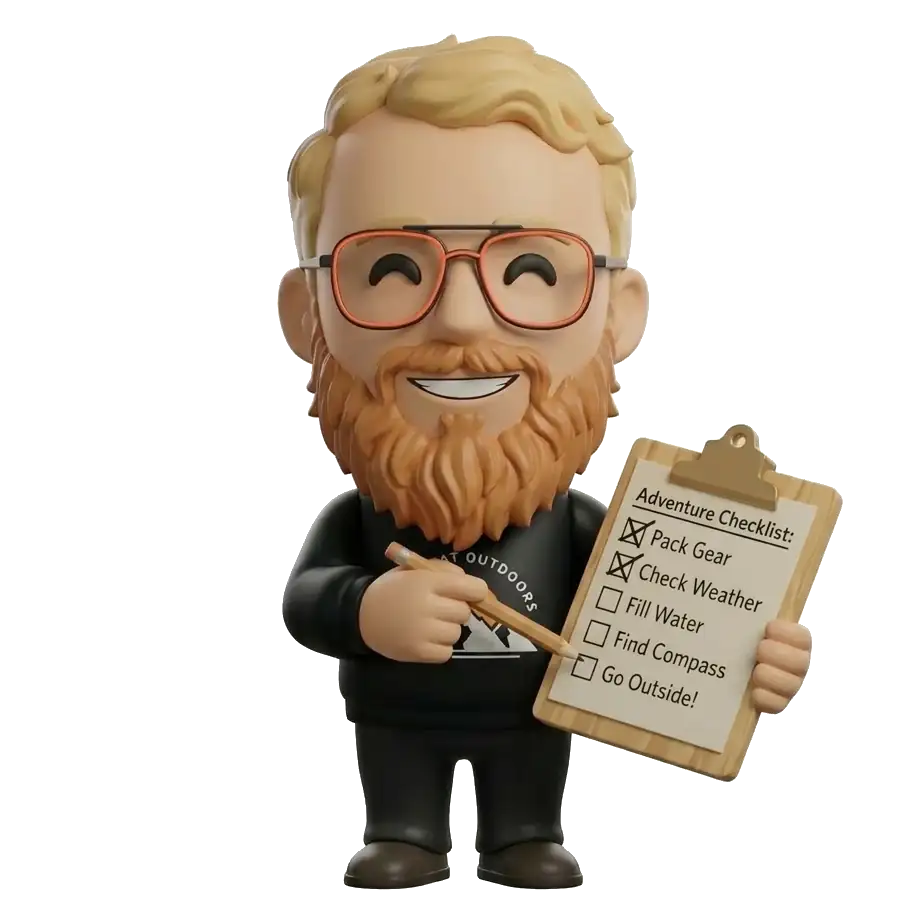
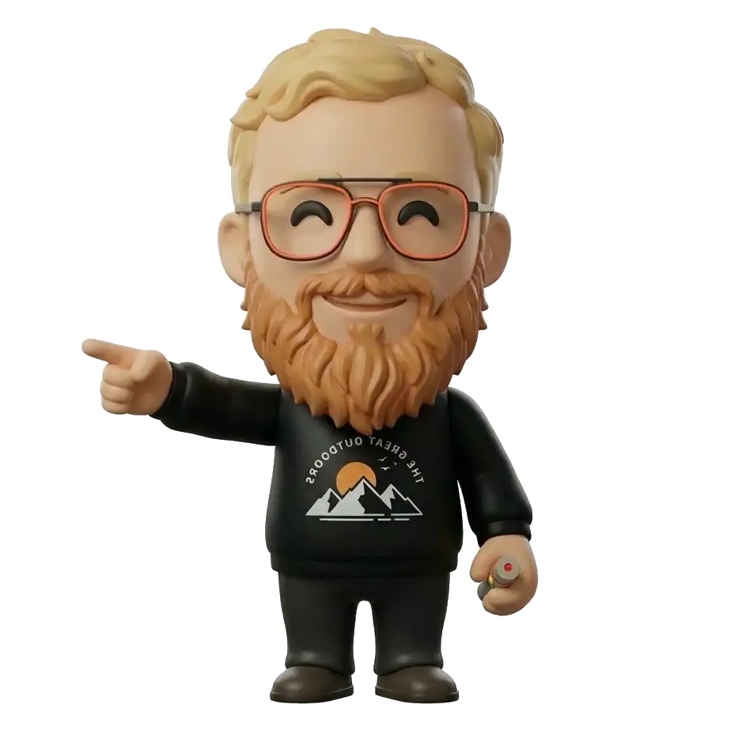
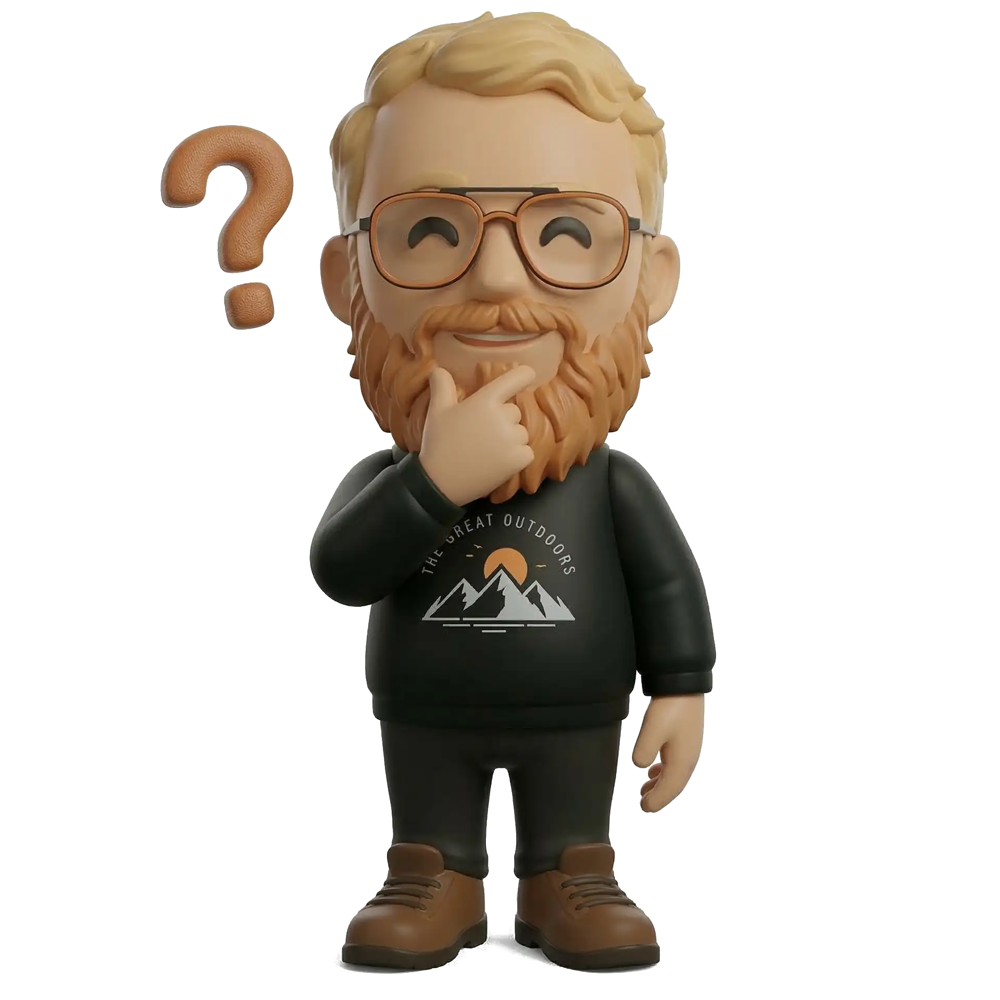

# Bonjour, je suis Rémi Dubois ! 👋
### Étudiant en CAP - Usages éducatifs des TICE

<!-- Note d'image générée par IA : Un informaticien souriant dans un style décontracté (t-shirt, lunettes), tenant une tasse de café devant un écran avec des éléments d'éducation flottants, style illustration 3D chaleureuse. -->

<!-- speaker_note: "Bonjour à tous, je m'appelle Rémi. Je suis ravi d'être parmi vous aujourd'hui pour me présenter rapidement." -->

---

# 💻 Mon parcours en bref

- **20 ans d'expérience** dans l'informatique.
- Les réseaux, le code, les ordinateurs... c'est mon terrain de jeu quotidien !
- Un profil très "tech" qui plonge aujourd'hui dans le grand bain de la **pédagogie**.
- *Mon défi :* Changer de casquette et voir l'outil numérique du point de vue de l'apprenant.

<!-- speaker_note: "Cela fait deux décennies que je suis dans l'IT. J'ai vu pas mal de choses évoluer, mais l'aspect éducatif est un nouveau challenge super stimulant pour moi." -->

---

# 🤝 Pourquoi ce CAP ? La vraie raison...

*Vous vous demandez peut-être ce qu'un informaticien vétéran fait ici ?*

**Je suis là pour accompagner Laurence !**
- C'est avant tout un beau **projet à deux**.
- L'occasion de partager une aventure commune et de se motiver mutuellement.
- (Et accessoirement, de s'entraider pour les devoirs le soir !)

<!-- speaker_note: "La réalité, c'est que je fais ce CAP à la base pour Laurence. C'est notre projet d'équipe, et ça rend l'apprentissage beaucoup plus fun." -->

---

# 🎓 Mes attentes pour ce cours

<!-- Note d'image générée par IA : Deux étudiants d'âge mûr qui collaborent joyeusement autour d'une tablette tactile dans une ambiance lumineuse et moderne. -->

- **Démystifier les TICE** : comprendre comment mes outils de tous les jours s'intègrent concrètement dans une salle de classe.
- **Échanger avec vous** : j'ai mon bagage technique, mais j'ai hâte d'apprendre de vos propres expériences !
- **Aller au bout de ce projet** avec Laurence, tout en enrichissant ma culture du numérique éducatif.

---

# Merci pour votre accueil ! 🎉

### Avez-vous des questions ?

<!-- speaker_note: "Merci de m'avoir écouté. Si vous avez des questions sur mon parcours ou si vous galérez avec un ordinateur cette année, n'hésitez pas !" -->