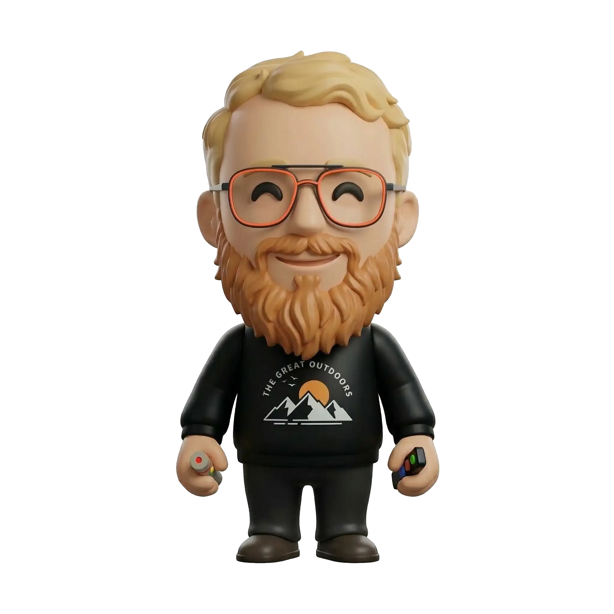
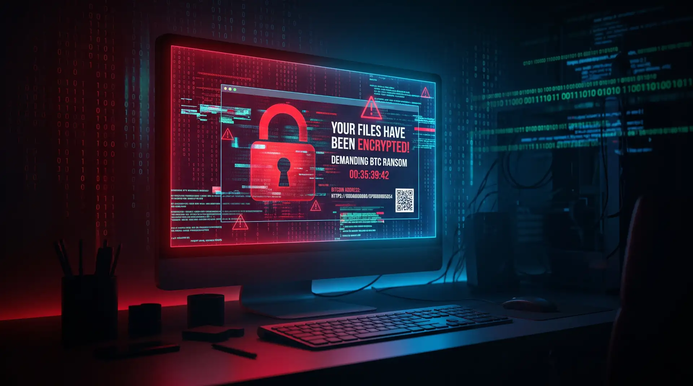
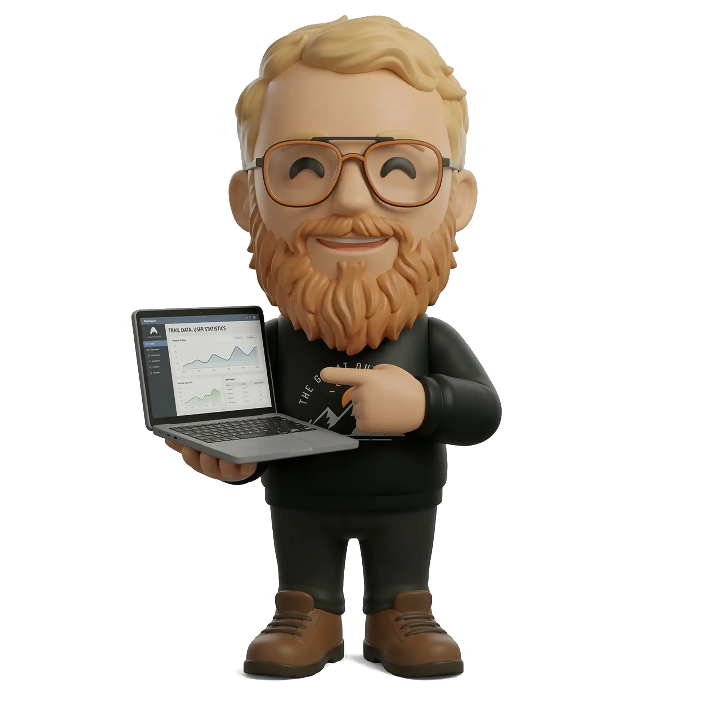

<!-- _class: lead center -->
<!-- _paginate: skip -->
<!-- _footer: "" -->

# L'importance des sauvegardes

## Ne soyez pas la prochaine victime...

<!-- Note : Bonjour à tous ! Aujourd'hui nous allons parler d'un sujet qui peut sembler rébarbatif, mais qui peut littéralement sauver votre année, voire votre future carrière en informatique : les sauvegardes. -->

---

# L'histoire de Léo

- Léo est étudiant en 3ème technique de transition.
- Il bosse sur son TP noté depuis 3 semaines.
- Le rendu est demain à 8h.
- Il a tout enregistré dans un dossier "Mes Documents".

<!-- Note : Je vais vous raconter une histoire vraie. Léo a travaillé dur. Il est fier de son projet, il a fait des nuits blanches et tout fonctionne à merveille. -->

---

<!-- _class: center -->

# Le Drame

### À 23h30, l'ordinateur de Léo fait un bruit étrange : *clic... clic...* puis écran bleu et redémarrage impossible.

<!-- Note : Et là, c'est le drame absolu. Le disque dur vient de lâcher, la veille de la remise. -->

---

# La réaction

- Le seum intergalactique absolu.
- Plus de code, plus de projet, tout a disparu.
- L'équivalent de tomber dans la lave avec tout son diamant sur Minecraft.
- Nuit blanche pour recommencer depuis zéro.

<!-- Note : Imaginez la panique. Léo a tout perdu en une seconde. Il a dû refaire 3 semaines de travail en une nuit, sous pression extrême, et bien sûr le résultat était moins bon. -->

---

# Ne soyez pas comme Léo

- Un ordinateur cassé se rachète.
- Le temps passé à coder **ne s'achète pas**.
- Le travail non sauvegardé n'existe virtuellement pas.

<!-- Note : La morale, c'est que le matériel se remplace, mais pas votre temps. Ne jouez pas avec le feu. En informatique, perdre des données c'est une faute professionnelle. -->

---

# Plan

1. C'est quoi une vraie sauvegarde ?
2. Les ennemis de vos données
3. La règle d'or du survivant (3-2-1)
4. La boîte à outils
5. Conclusion

<!-- Note : Voici ce que nous allons voir aujourd'hui pour éviter la catastrophe et devenir de vrais professionnels soucieux de leur travail. -->

---

# 1. C'est quoi une sauvegarde ?

- Une **copie de sécurité** indépendante de l'original.
- Elle permet de restaurer un système ou des fichiers.
- C'est un filet de sécurité indispensable en informatique.

<!-- Note : Entrons dans le vif du sujet. Tout le monde croit savoir ce qu'est une sauvegarde, mais voyons la vraie définition. -->

---

# L'illusion du CTRL+S

- Sauvegarder dans le même dossier n'est **pas** une sauvegarde.
- Ce n'est qu'un enregistrement de l'état de votre fichier.
- Si le disque meurt, le fichier *et* l'enregistrement meurent ensemble.

<!-- Note : Beaucoup d'élèves me disent "Mais si, j'ai sauvegardé, j'ai fait CTRL+S". Non, vous avez enregistré. Si le PC brûle, votre fichier enregistré brûle avec. -->

---

# L'illusion du Cloud (Synchronisation)

- Google Drive ou OneDrive *synchronisent* vos fichiers.
- Si vous supprimez un fichier par erreur sur le PC...
- ...il se supprime aussi sur le Cloud instantanément !

<!-- Note : Le Cloud est génial, mais attention : ce n'est souvent qu'un miroir de votre ordinateur. Ce n'est pas une sauvegarde infaillible contre les erreurs de manipulation. -->

---

<!-- _class: lead -->
# 💡 Quizz Interactif

### Le dossier OneDrive de mon ordinateur portable est-il une sauvegarde fiable pour mon projet ?

1. Oui, car c'est dans le Cloud protégé par Microsoft.
2. Non, car si le PC casse, je perds tout.
3. Non, car une mauvaise manipulation sur mon PC synchronise l'erreur partout.

<!-- Note : A votre avis ? Je vous écoute. (Attendre les réponses et argumenter). La bonne réponse est la 3. Si un ransomware chiffre votre PC, OneDrive va sagement synchroniser les fichiers chiffrés sur le Cloud ! -->

---

# 2. Les ennemis de vos données

Pourquoi perdons-nous nos données si fréquemment ?

<!-- Note : Passons à la deuxième partie. Quelles sont les vraies menaces ? Pourquoi a-t-on besoin de copies de sécurité ? -->

---

<!-- _class: split -->
# Les pannes et les accidents

> ### La panne matérielle
> - Disque dur mécanique HS.
> - Clé USB tordue dans le sac.
> - SSD qui meurt sans prévenir.

> ### Les catastrophes
> - Le verre de soda sur le clavier.
> - PC oublié dans le bus.
> - Le vol.

<!-- Note : Les disques durs mécaniques sont fragiles. Un petit choc et c'est fini. Sans parler du fameux verre d'eau renversé, un classique ! -->

---

# Les cyberattaques

- **Ransomware** : Un virus chiffre tous vos fichiers.
- Les hackers demandent une rançon pour la clé de déchiffrement.
- Le Cloud synchronisé peut aussi être infecté s'il est actif.

<!-- Note : Les ransomwares sont le fléau actuel. Vos fichiers deviennent illisibles. Sans une sauvegarde totalement déconnectée de votre ordinateur, vous perdez tout. -->

---

# L'erreur humaine

- La cause **numéro 1** de perte de données.
- "J'ai formaté le mauvais lecteur par erreur."
- "J'ai écrasé mon code fonctionnel avec une ancienne version buggée."

<!-- Note : Soyons honnêtes, le plus grand danger pour votre PC se trouve souvent entre la chaise et le clavier. L'erreur humaine est responsable de la majorité des pertes en entreprise. -->

---

<!-- _class: lead -->
# 💡 Débat / Vote

### Quelle est la cause que vous redoutez le plus pour vos propres projets scolaires ?

1. La clé USB perdue, volée ou tordue.
2. Le PC qui meurt de cause naturelle (panne).
3. La suppression ou l'écrasement par erreur de votre code.

<!-- Note : Levez la main. Qui utilise une clé USB ici ? C'est le support le moins fiable au monde sur le long terme. Les clés USB sont faites pour transférer, pas pour stocker de façon pérenne ! -->

---

# 3. La Règle du 3-2-1

- C'est le Saint Graal de la sauvegarde informatique.
- Utilisée par les professionnels de l'IT dans le monde entier.
- Une stratégie simple et redoutable pour ne **jamais** rien perdre.

<!-- Note : Voici la solution ultime. Si vous retenez une seule chose de ce cours aujourd'hui, c'est cette règle. La règle du 3, 2, 1. -->

---

<!-- _class: center -->

# <!-- fit --> 3 COPIES

### L'original de vos données + 2 copies de sauvegarde.

<!-- Note : Premièrement, vous devez avoir vos données en 3 exemplaires. L'original sur lequel vous travaillez, et deux copies de sauvegarde. Pourquoi ? Mathématiquement, les probabilités que 3 copies lâchent exactement en même temps sont quasi nulles. -->

---

<!-- _class: center -->

# 2 SUPPORTS DIFFÉRENTS

### Par exemple : Le SSD interne de votre PC + Un disque dur externe USB.

<!-- Note : Deuxièmement, ces copies doivent être sur 2 types de supports physiques différents. Si votre PC brûle à cause d'une surtension, la copie sur le disque dur externe non branché survivra. -->

---

<!-- _class: center -->

#  1 COPIE HORS SITE

### Loin de votre PC d'origine (Sur un Cloud sécurisé ou chez vos parents).

<!-- Note : Enfin, 1 copie hors site, donc ailleurs physiquement. Si un cambrioleur vole votre sac avec votre PC ET votre disque dur externe, ou en cas d'incendie, la copie dans le Cloud vous sauvera la mise. -->

---

# Pourquoi tant de précautions ?

- Les vols de sacs à dos sont fréquents chez les étudiants.
- Les pannes matérielles n'avertissent pas.
- La loi de Murphy : tout ce qui peut mal tourner, tournera mal, au pire moment.

<!-- Note : Ça peut paraître extrême et paranoïaque, mais c'est l'expérience qui parle. La loi de Murphy frappe toujours au pire moment, comme pour notre ami Léo du début. -->

---

<!-- _class: lead -->
# 💡 Exercice

### Concevez un plan 3-2-1 pour votre TP noté de fin d'année.
Prenez 2 minutes et imaginez : où seront vos 3 copies, sur quels 2 supports, et quelle sera votre copie hors site.

<!-- Note : À vous de jouer. Réfléchissez à votre plan. (Attendre quelques minutes puis demander à un ou deux étudiants de partager leur idée au reste de la classe). -->

---

# Exemple de bon plan 3-2-1 pour un projet dev

- **Copie 1 (Original)** : Sur le SSD de votre ordinateur portable.
- **Copie 2 (Support 2)** : Sur un disque dur externe que vous branchez chaque soir.
- **Copie 3 (Hors site)** : Poussé sur un dépôt privé **GitHub**.

<!-- Note : Voici l'idéal pour vous en informatique. Vous codez sur le PC, vous faites un backup d'image sur un disque dur externe, et vous pushez vos sources sur GitHub ! C'est infaillible. -->

---

# 4. La boîte à outils du survivant

Comment mettre ça en place techniquement ?

<!-- Note : Concrètement, avec quoi allez-vous faire ça ? Quels outils pour quels usages ? -->

---

<!-- _class: split -->
# Les supports physiques

> ### À éviter
> - La clé USB (Fragile, se perd, connecteur qui casse).
> - La carte SD (Lente, peu fiable sur le long terme).

> ### Les bons choix
> - Disque Dur Externe (HDD - Moins cher, idéal pour les gros fichiers).
> - Disque Externe SSD (Ultra rapide, insensible aux chocs physiques).

<!-- Note : Arrêtez de faire confiance aux clés USB pour vos projets importants de l'année. Investissez dans un petit disque externe SSD, ça coûte le prix d'un jeu vidéo et ça vous durera des années. -->

---

# L'arme absolue du développeur : Git

- Git n'est pas seulement un outil de versioning.
- Combiné à GitHub / GitLab, c'est votre copie hors site parfaite pour le code.
- Permet de revenir à une version précédente (bye bye l'erreur humaine !).

<!-- Note : Git est fait pour ça. Si vous supprimez une fonction par erreur, Git peut vous la retrouver via l'historique. Si votre PC brûle, vous faites un "git clone" sur un autre PC et c'est reparti en 2 minutes ! -->

---

# L'automatisation

> "Une sauvegarde manuelle est une sauvegarde qu'on finit par oublier de faire."

- Utilisez l'Historique des Fichiers (intégré à Windows).
- Utilisez Time Machine (si vous êtes sur Mac).
- L'ordinateur doit faire le travail à votre place, silencieusement et régulièrement.

<!-- Note : Ne comptez pas sur votre mémoire. Le vendredi soir après une semaine de cours, vous n'aurez pas l'énergie de faire une sauvegarde. Laissez le système d'exploitation la faire pour vous en tâche de fond. -->

---

# Le chat de Schrödinger de la sauvegarde

- Une sauvegarde qu'on n'a jamais testée est dans un état incertain.
- Elle fonctionne ET ne fonctionne pas en même temps.
- **Testez toujours la restauration !**
- Un fichier corrompu copié 3 fois restera un fichier corrompu.

<!-- Note : Règle d'or en entreprise : Beaucoup de gens font des sauvegardes pendant des années, et le jour du crash, le fichier backup est illisible. Testez vos restaurations 1 à 2 fois par an ! -->

---

# 5. Conclusion

- Les accidents n'arrivent pas qu'aux autres (Ne soyez pas Léo).
- La synchronisation Cloud n'est pas une sauvegarde complète.
- Appliquez rigoureusement la règle du **3-2-1**.
- Utilisez **Git** pour protéger votre code.
- Automatisez tout ce que vous pouvez.

<!-- Note : Pour résumer notre séance, la sécurité de vos données est de votre responsabilité. Appliquez le 3-2-1, utilisez Git, et vous dormirez sur vos deux oreilles. -->

---

<!-- _class: lead -->
# 💡 Engagement

### Qui s'engage, dès ce soir en rentrant, à vérifier ou configurer au moins une vraie sauvegarde pour ses cours ?

<!-- Note : Je veux voir des mains levées. C'est un tout petit effort de 10 minutes ce soir qui vous sauvera peut-être des nuits blanches et un échec en fin d'année scolaire. -->

---

<!-- _class: lead center -->
<!-- _paginate: skip -->

# Merci !

## Avez-vous des questions ?

<!-- Note : Merci pour votre attention, j'espère que vous avez compris l'enjeu. Y a-t-il des questions ? -->
